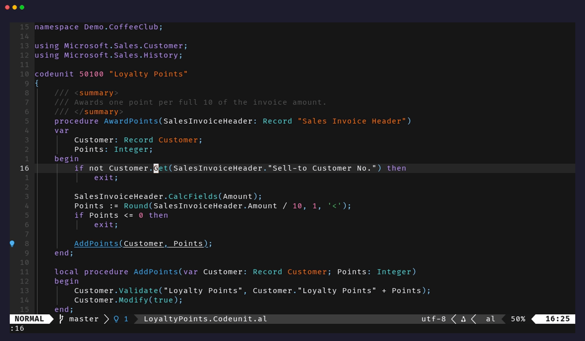
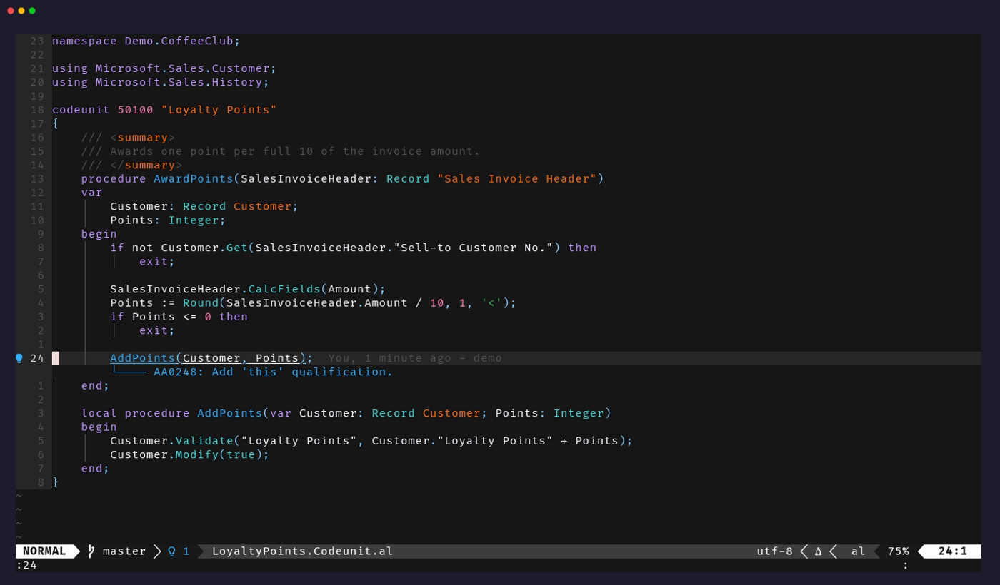
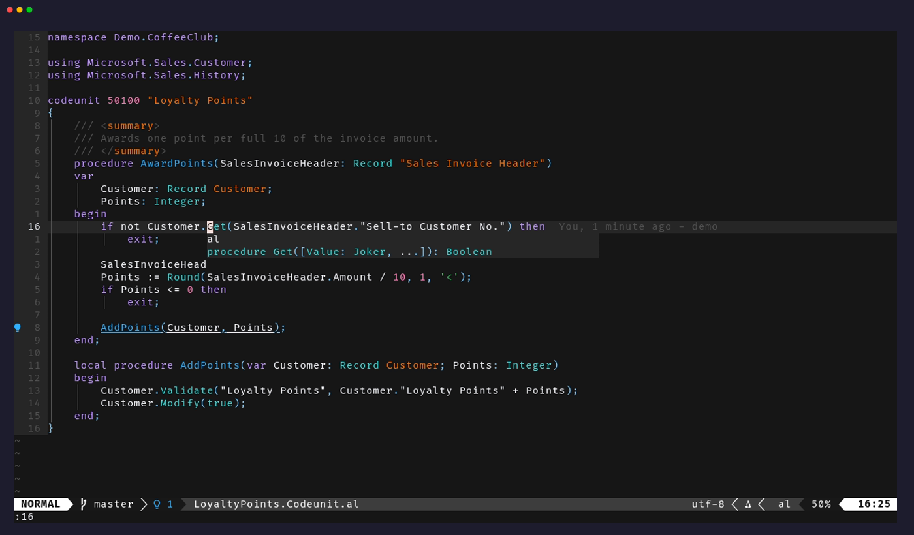
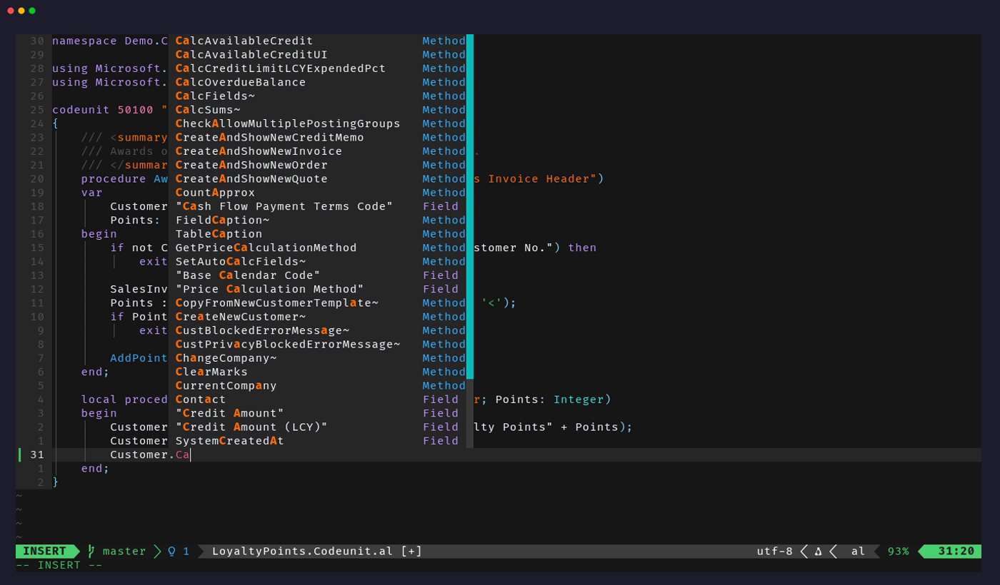
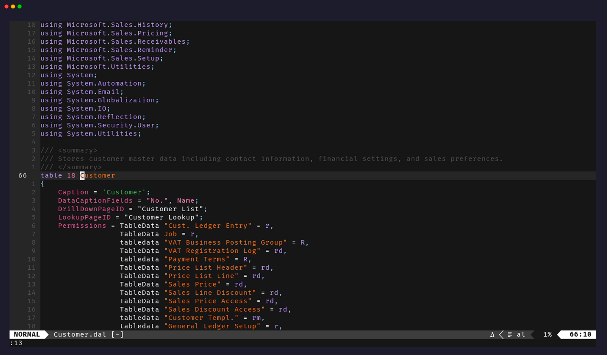
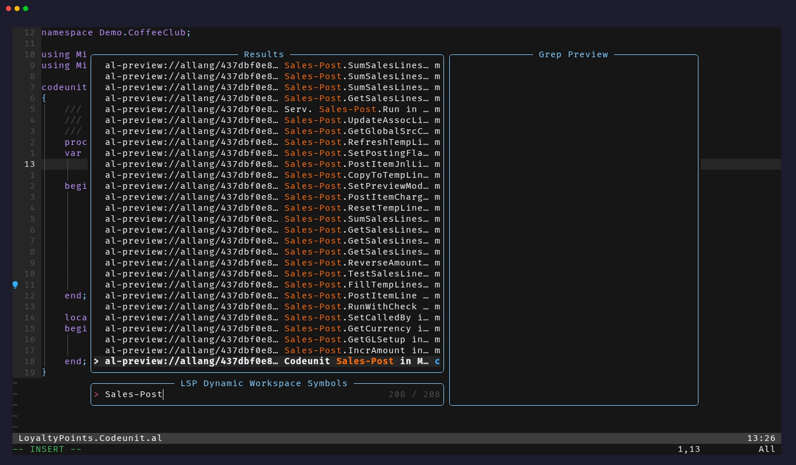

<div align="center">

# nvim-al

**Business Central AL in Neovim, on Microsoft's own language server.**

[](https://github.com/philipp-mlr/nvim-al/actions/workflows/ci.yml)
[](https://github.com/philipp-mlr/nvim-al/tags)
[](https://neovim.io)
[](https://marketplace.visualstudio.com/items?itemName=ms-dynamics-smb.al)
[](LICENSE)



</div>

nvim-al starts the language server and debug adapter that ship inside
Microsoft's AL Language extension for VS Code, and speaks to them the way VS
Code does. Nothing is reimplemented: the compiler, the analyzers and the
debugger come from the extension, so Neovim shows the same diagnostics as VS
Code with the same extension version and settings.

You keep your editor. nvim-al has no UI of its own and needs no other plugin
(nvim-dap only for debugging). Results land in quickfix, signs, virtual text
and notifications, and pickers such as Telescope work as they do for any other
language.

## What you get

<table>
<tr>
<td width="50%"></td>
<td width="50%"></td>
</tr>
<tr>
<td><b>Diagnostics</b> from the compiler and every analyzer your workspace configures: CodeCop, UICop, PerTenantExtensionCop, AppSourceCop, and third-party ones such as ALCops.</td>
<td><b>Hover</b> with signatures and documentation, for your code and for Microsoft's.</td>
</tr>
<tr>
<td></td>
<td></td>
</tr>
<tr>
<td><b>Completion</b> for methods, fields and objects, with snippets.</td>
<td><b>Go to definition</b> into your projects and into symbol packages. Base Application objects open as read-only previews.</td>
</tr>
<tr>
<td colspan="2" align="center"></td>
</tr>
<tr>
<td colspan="2" align="center"><b>Workspace symbols</b> across your apps and their dependencies, procedures and fields included. Here: Telescope searching the Base Application for <code>Sales-Post</code>.</td>
</tr>
</table>

Also included:

- references, implementations, rename, formatting, code actions and signature help
- `gD` and type definition: from `Customer` in `Customer.Get()` to table 18
- semantic colors for AL's own token types, layered over a treesitter grammar
- multi-project workspaces read from your `*.code-workspace` files, and git
  worktrees with no extra setup
- build, workspace compile, publish, symbol download, tests and debugging, all
  as `:AL` commands

## Requirements

- Neovim 0.11 or newer
- .NET 10 with ASP.NET Core: `dotnet --list-runtimes` must list
  `Microsoft.NETCore.App 10.x` and `Microsoft.AspNetCore.App 10.x`
- The [AL Language extension](https://marketplace.visualstudio.com/items?itemName=ms-dynamics-smb.al),
  version 30.0 or newer, either installed in VS Code or unzipped from a `.vsix`
- `curl`, for the target checks before publishing, tests and debugging
- Optional: [nvim-dap](https://github.com/mfussenegger/nvim-dap) for debugging
- Optional: an AL treesitter grammar such as
  [tree-sitter-al](https://github.com/SShadowS/tree-sitter-al) for colors
  before the server is ready

nvim-al does not bundle or redistribute Microsoft binaries. It uses the
extension you already have.

## Install

With any plugin manager. Using Neovim's built-in one (Neovim 0.12+):

```lua
vim.pack.add({ "https://github.com/philipp-mlr/nvim-al" })
```

With lazy.nvim:

```lua
{ "philipp-mlr/nvim-al" }
```

No lazy-loading needed: at startup the plugin only registers autocommands, and
the language server starts with the first AL file you open.

`setup()` is optional. Without it, nvim-al looks for the newest
`ms-dynamics-smb.al-*` in `~/.vscode/extensions` (and the `-server`,
`-insiders` and Cursor folders) and uses `dotnet` from your `PATH`:

```lua
require("nvim-al").setup({
  extension_path = nil,  -- an unzipped .vsix instead; also $NVIM_AL_EXTENSION
  dotnet = "dotnet",
  analyzer_folder = nil, -- where ${analyzerFolder} points, e.g. ALCops DLLs
  diagnostics = { workspace_min_severity = "warning" }, -- for files you have not opened
})
```

Then open an `.al` file and run `:checkhealth nvim-al`.

<details>
<summary><b>Nix</b></summary>

The flake provides the plugin and a pinned AL extension. The extension is
unfree, so build it with your own nixpkgs, which has to allow unfree packages:

```nix
let
  system = pkgs.stdenv.hostPlatform.system;
  nvim-al = inputs.nvim-al.packages.${system}.default;
  al-extension = inputs.nvim-al.lib.mkAlExtension pkgs;
in {
  # add nvim-al to your plugins, then in setup():
  #   extension_path = "${al-extension}",
  #   dotnet = "${pkgs.dotnetCorePackages.aspnetcore_10_0}/bin/dotnet",
}
```

The extension directory in the Nix store is read-only. If your workspace uses
`${analyzerFolder}` for third-party analyzers, point `analyzer_folder` at them.

</details>

## How it finds your project

From the current file, nvim-al walks up to the git root. The nearest
`app.json` is the project. If a `*.code-workspace` file on the way lists that
project, the outermost one is the workspace; otherwise the project is a
workspace of its own.

One language server runs per workspace, and the active project follows your
buffer. Settings come from the workspace file and each folder's
`.vscode/settings.json`, in the same order VS Code applies them. Launch
configurations come from `.vscode/launch.json` or the workspace file.

Every worktree is its own root, so two branches can be open side by side,
each with its own server.

## Commands

| Command | What it does |
|---|---|
| `:AL info` | Toolchain, workspace, project closure and effective settings |
| `:AL build` | Build the current project; reports any tracked files the build rewrote |
| `:AL restore` | Put back the tracked files the last build rewrote |
| `:AL compile[!]` | Compile the whole workspace with `altool`; findings go to quickfix |
| `:AL publish` | Build and publish; offers in-repo dependencies the target is missing |
| `:AL symbols [global]` | Download symbols from the target, or from Microsoft's NuGet feeds |
| `:AL test [id [method]]` | Run the test at the cursor, or the given codeunit or method |
| `:AL test file` / `:AL test last` | Run the whole test codeunit / repeat the previous run |
| `:AL debug` | Start debugging with nvim-dap |
| `:AL log [op]` | Output of the last build, compile, publish, symbols, test or debug run |
| `:AL target` | Choose the launch configuration again |
| `:AL restart` | Restart the language server |

nvim-al maps `gd` only if you have not mapped it yourself, and sets
`'tagfunc'` so `<C-]>` jumps to definitions. Everything else goes through
Neovim's standard LSP mappings and your pickers.

## Publishing, tests and debugging

Publishing and tests run through `altool`, which ships with the extension. The
target is a launch configuration from `.vscode/launch.json`; nvim-al asks once
per project when there is more than one, and `:AL target` asks again.

- Before anything slow, nvim-al checks that the server answers and accepts
  your credentials. If not, it says which: server unreachable, wrong
  `serverInstance` or port, credentials rejected, or service tier not ready.
- Publishing reads which extensions the server has installed. If an app from
  the same repository that yours depends on is missing or has a different
  version, nvim-al offers to publish it first, in dependency order.
- Tests mark each `[Test]` procedure with ✓ or ✗. Failure messages appear
  next to the failing procedure and in quickfix.
- Debugging runs the extension's AL debug adapter through nvim-dap, for attach
  and launch configurations, breakpoints included. Launch configurations build
  first, as in VS Code.

## Progress and feedback

Long operations show one line that moves through its phases: a native
progress message on Neovim 0.12 (`nvim_echo` with kind `progress`), a plain
echo line on 0.11. Publishing an app whose two dependencies are missing on the server looks like
this, one line updated in place:

```
Sales Extension: building
Sales Extension: compiling Base Extension (12s)
Sales Extension: publishing to bc-dev (31s)
Sales Extension: published to bc-dev (+2 dependencies) in 74s
```

When something fails, the message carries the reason the server or compiler
gave, and `:AL log` opens the full output. For a statusline,
`require("nvim-al").statusline()` returns a ready string, and the
`User NvimAlStatus` event fires on every change (`:help nvim-al-statusline`).

## Repository hooks

Each step can be replaced per repository, for example from a `.nvim.lua`,
without forking the plugin:

```lua
require("nvim-al").setup({
  hooks = {
    compile = function(ctx)        -- replace :AL compile
      vim.cmd("botright split | terminal ./scripts/compile")
      return true
    end,
    launch = function(folder)      -- launch configurations from a script
      return vim.json.decode(vim.fn.system({ "./scripts/launch-config", folder.path }))
    end,
  },
})
```

Hooks exist for workspace selection, settings, build, compile, publish, test
and launch configurations. See `:help nvim-al-hooks`.

## Credentials

For `UserPassword` targets, nvim-al takes `BC_SERVER_USERNAME` and
`BC_SERVER_PASSWORD` from the environment, or asks once per server and keeps
the answer in memory for the session. Credentials are never written to disk
and never sent to the language server. They go to `altool`, `curl` and the
debug adapter through environment variables or stdin, not the command line.

One caveat: at log level `DEBUG` or `TRACE`, nvim-dap writes the adapter's
environment, password included, to `dap.log`. The default level does not.

## Limitations

- Authentication: `UserPassword` and `Windows`, which covers on-prem servers
  and Docker containers. Entra ID / SaaS sandboxes are not supported yet.
- The server does not provide document highlight or call hierarchy.
- Semantic colors appear once the server has loaded the workspace, which
  takes 15 to 20 seconds on a large one. A treesitter grammar fills the gap.
- Some VS Code commands have no equivalent yet, among them the page designer,
  the event recorder, permission set generation and snapshot debugging.

## How it works

nvim-al runs `Microsoft.Dynamics.Nav.EditorServices.Host` from the extension's
`bin` folder, with the same arguments, workspace messages and settings VS Code
sends. Several standard requests that the server leaves unanswered are filled
in from its own AL-specific ones:

| Neovim asks for | nvim-al answers with |
|---|---|
| `textDocument/definition`, `declaration` | `al/gotodefinition`, plus `al/previewDocument` for symbol packages |
| `textDocument/typeDefinition` | two go-to-definition hops: symbol → declaration → type |
| `workspace/symbol` | `al/symbolSearch`, plus `al/getApplicationObject` for dependency objects |

[`docs/protocol.md`](docs/protocol.md) documents the protocol as observed,
with the probes behind each finding. It is also the place to start if you
want to contribute.

## Development

```sh
scripts/test                            # unit tests (mini.test, fake language server)
scripts/test tests/unit/test_lsp.lua    # one file
stylua --check .
```

Integration tests start the real language server. They run when
`NVIM_AL_TEST_EXTENSION` points at an AL extension and
`NVIM_AL_TEST_PACKAGES` at a folder of symbol packages. Changes go in
[`CHANGELOG.md`](CHANGELOG.md).

## Credits

nvim-al builds on other people's work:

- [al.nvim](https://github.com/abonckus/al.nvim) by abonckus showed how to
  build a project's reference closure from `app.json`. nvim-al's closure logic
  started there.
- [ALNvim](https://github.com/drs76/ALNvim) by drs76 collected the language
  server's quirks and the robustness lessons that came with them.
- Microsoft's [AL Language extension](https://marketplace.visualstudio.com/items?itemName=ms-dynamics-smb.al)
  provides the language server, compiler, analyzers and debug adapter that
  nvim-al runs. Its behaviour in VS Code is the reference for everything here.
- [tree-sitter-al](https://github.com/SShadowS/tree-sitter-al) by SShadowS
  colors AL before the language server is ready.
- [ALCops](https://github.com/ALCops/Analyzers) is the third-party analyzer
  suite nvim-al was tested against.
- [mini.test](https://github.com/nvim-mini/mini.nvim) runs the test suite, and
  [VHS](https://github.com/charmbracelet/vhs) recorded the screenshots and the
  demo.

## License

[MIT](LICENSE). AL Language, Business Central and Dynamics 365 are trademarks
of Microsoft. This project is not affiliated with Microsoft.
